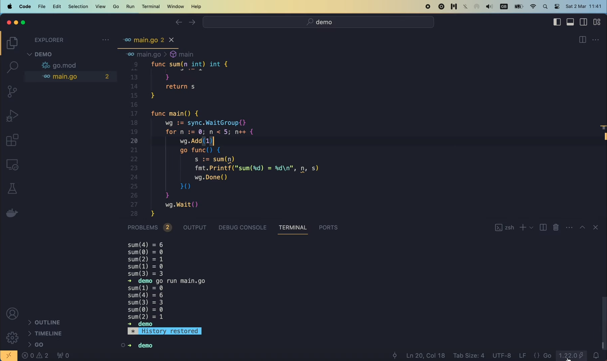

# Go 1.22 fixed the most common for-loop trap

[Оригинал](https://www.youtube.com/watch?v=rIHO9TqJtQQ)

Hello everyone, and welcome to Tech School! As you might know, the resent
released version of Go 1.22 has introduced 2 important changes to the ["for"
loop](https://tip.golang.org/doc/go1.22#language).

The first one is pretty trivial: "for" loop may now range over integers.
When you write "range 10" like this,

```go
for i := range 10 {
    fmt.Println(10 - i)
}
```

it's basically the same as running from 0 to 9.

But the second change may not be easy to understand. In previous versions 
of Go, the variables declared by a "for" loop were created only once, and
updated by each iteration. But since Go 1.22, each iteration will create
a new variable. And this is a great change, because it fixed 1 of the 
most common mistakes that we often made when using for loop with go 
routine and closure.

Let me show you a concrete example. Let's say we want to write a function
to compute the sum of all non-negative integers less than a number `n`.
So let's declare function `sum`, which takes an integer `n` as input, and
also returns an integer. We will store the sum in this variable `s`, 
initially set to 0. Then, we can use the for loop to range over all 
non-negative integers less than `n`.

```go
package main

// compute sum of all non-negative integers less than n
func sum(n int) int {
	s := 0
	for i := range n {
		
    }
}

func main() {
	
}
```

Now, if I write range `n` like this, it doesn't work, because I'm still 
using Go version 1.21. You can check the current running version with
the "go version" command.

```shell
go version
go version go1.21.1 darwin/amd64
```

So for the older versions of Go, we have to write it like this:

```go
package main

// compute sum of all non-negative integers less than n
func sum(n int) int {
	s := 0
	for i := 0; i < n ; i++ {

    }
}

func main() {
	
}
```

Then inside the loop, let's add `i` to the value of `s`. And finally return
`s` at the end of the function.

```go
package main

// compute sum of all non-negative integers less than n
func sum(n int) int {
	s := 0
	for i := 0; i < n ; i++ {
		s += i
    }
	return s
}

func main() {
	
}
```

OK, now in the `main` function, let's say we want to print out the sum 
over multiple values of `n`. So I'm gonna run another for loop of `n` from
0 up to 5. Inside the loop, let's compute `sum(n)` and assign its result to
`s`. Then print out a message saying `sum of n equals s`.

```go
package main

import "fmt"

// compute sum of all non-negative integers less than n
func sum(n int) int {
	s := 0
	for i := 0; i < n ; i++ {
		s += i
    }
	return s
}

func main() {
	for n := 0; n < 5; n++ {
		s := sum(n)
		fmt.Printf("sum(%d) = %d\n", n, s)
    }
}
```

If we run this code, it will print out 5 lines with the correct result, 

```shell
go run main.go
sum(0) = 0
sum(1) = 0
sum(2) = 1
sum(3) = 3
sum(4) = 6
```

from `sum(0)` to `sum(4)`. So there's nothing special here.

But the problem might arise when we try to run these computations in 
parallel.

When the number `n` is large, computing the sums in parallel can have a 
huge impact on the speed, especially when you have multiple cores on 
your computer.

Let's start a new go routine, and move these 2 statements

```go
s := sum(n)
fmt.Printf("sum(%d) = %d\n", n, s)
```

inside the closure function.

We have to add a pair of parenthesis here

```go
go func() {
    s := sum(n)
    fmt.Printf("sum(%d) = %d\n", n, s)
}()
```

to call that function. OK, so now these sum computation should run in 
parallel. But will they print out correct values as we expect?

Let's run it to see what happens!

```shell
go run main.go
```

Oops, nothing is printed on the screen. That's because we forgot to wait
for the go routines to complete. So let's create a new wait group variable
here.

```go
func main() {
    wg := sync.WaitGroup()
    ...
}
```

And before start the go routine, we should call `wg.Add(1)` to increase 
the number of routines this group should wait for. Then we must call 
`wg.Done()` at the end of the go routine to report that it has completed.
Finally, at the end of the main function,

```go
func main() {
    wg := sync.WaitGroup()
	for n := 0; n < 5; n++ {
		wg.Add(1)
		go func() {
            s := sum(n)
            fmt.Printf("sum(%d) = %d\n", n, s)
			wg.Done()
        }()
    }
	wg.Wait()
}
```

let's call `wg.Wait()` to wait for all go routines to complete. Now, if we 
run the code, it will print out 5 lines.

```shell
go run main.go
sum(5) = 10
sum(5) = 10
sum(5) = 10
sum(5) = 10
sum(5) = 10
```

But look at the content, it's so strange, isn't it? All lines have the same
content: `sum(5) = 10`.

This is not what we expected. We want to have each sum from 0 to 4. So now
you see the problems of all go versions before 1.22. This issue happens 
because of the way the `for` loop variable is used. In this go version 
that I'm using, the `for` loop variable `n` is created only once, and shared
between iterations. So when we started the go routine, the value of `n` 
kept increasing until it reaches 5. But this ran so fast that it had reached
5 before any of the go routine executed their first statement to compute
the sum. That's why all of the go routine computed the sum for n = 5 as 
we've seen. This is a well known issue in Golang community, and there are 
several ways we can fix it.
For example: declaring a local variable `n` inside the `for` loop variable 
and set its value to the current value of the loop variable. This local 
variable will maintain the current value of `n`, so we can safely use it
inside the go routine closure.

```go
func main() {
    wg := sync.WaitGroup()
	for n := 0; n < 5; n++ {
        n := n
		wg.Add(1)
		go func() {
            s := sum(n)
            fmt.Printf("sum(%d) = %d\n", n, s)
			wg.Done()
        }()
    }
	wg.Wait()
}
```

Thus, when we execute the code, it will print out 5 different sums as we 
expected.

```shell
go run main.go
sum(4) = 6
sum(0) = 0
sum(2) = 1
sum(1) = 0
sum(3) = 3
```

Of course, their order is not strictly increasing from `sum(0)`
to `sum(4)` like when we run them sequentially. But the important point is,
eventually, all 5 different sums are computed.

Another way to fix it, is to declare `n` as an argument of the closure 
function, and pass in the current value of the for loop variable into that
function when we call it like this.

```go
func main() {
    wg := sync.WaitGroup()
	for n := 0; n < 5; n++ {
        n := n
		wg.Add(1)
		go func(n int) {
            s := sum(n)
            fmt.Printf("sum(%d) = %d\n", n, s)
			wg.Done()
        }(n)
    }
	wg.Wait()
}
```

This will also safely capture and store the current value of `n` for the 
closure to use, and as result, the printed output will be correct, just like
before.

```shell
go run main.go
sum(1) = 0
sum(4) = 6
sum(3) = 3
sum(0) = 0
sum(2) = 1
```

OK, so now you know the issue with for loop variable in old versions of Go.
But starting from Go 1.22, this issue has been fixed, since the go compiler
will create a [new variable](https://tip.golang.org/doc/go1.22#language) 
for each iteration.

So let's install Go 1.22 and give it a try!

I'm gonna head over to [go.dev](https://go.dev/) and download the latest
go version for my OS. Then follow the instruction to install it. After the 
new version of Go is installed, we have to restart VSCode to recognize it.



But somehow, the warning message for the loop variable is still here ("loop
variable n captured by func literal"). We'll see how to fix this in a moment.
For now, let's try to execute the code to see what happens.

```go
func main() {
    wg := sync.WaitGroup()
	for n := 0; n < 5; n++ {
		wg.Add(1)
		go func() {
            s := sum(n)
            fmt.Printf("sum(%d) = %d\n", n, s)
			wg.Done()
        }()
    }
	wg.Wait()
}
```

```shell
go run main.go
sum(4) = 6
sum(0) = 0
sum(3) = 3
sum(1) = 0
sum(2) = 1
```

Alright, so it seems to be working pretty well. All 5 different sums are 
computed and printed out on the screen. So Go1.22 indeed fixed the issue
with "for" loop variable.

Now let's try using the range over integer feature. Here I'm gonna replace
this long "for" loop with just "range n".

```go
func sum(n int) int {
    s := 0
    for i := range n {
        s += i
    }
	return s
}
```

And this "for" loop with "range 5".

```go
func main() {
    wg := sync.WaitGroup()
	for n := range 5 {
		wg.Add(1)
		go func() {
            s := sum(n)
            fmt.Printf("sum(%d) = %d\n", n, s)
			wg.Done()
        }()
    }
	wg.Wait()
}
```

Interestingly, VSCode is still showing the "cannot range over integer" error
message. That's because in the `go.mod` file, we're still setting the go
version to `1.21.1`. Let's update this to go `1.22.0` and save the file.

```go.mod
module demo

go 1.22.0
```

Now, when we go back to the `main.go` file, all the error and warning 
messages for the "range over integer" as well as the "for loop variable" 
are gone. And we can run the code successfully without any problems.

```shell
go run main.go
sum(4) = 6
sum(1) = 0
sum(2) = 1
sum(0) = 0
sum(3) = 3
```

So there you have it!

From now on, we will no longer have to worry about the issue with for loop 
variables being used in a go routine closure function.

I hope this lecture was interesting and useful for you. Thanks a lot for
watching, happy learning, and see you in the next video!