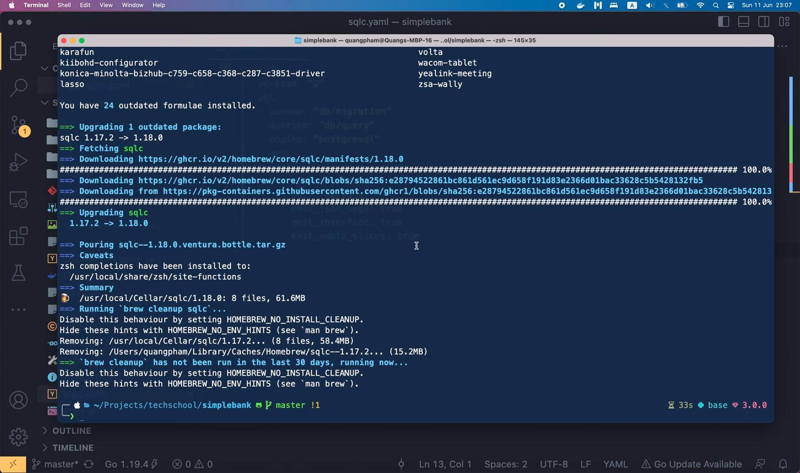
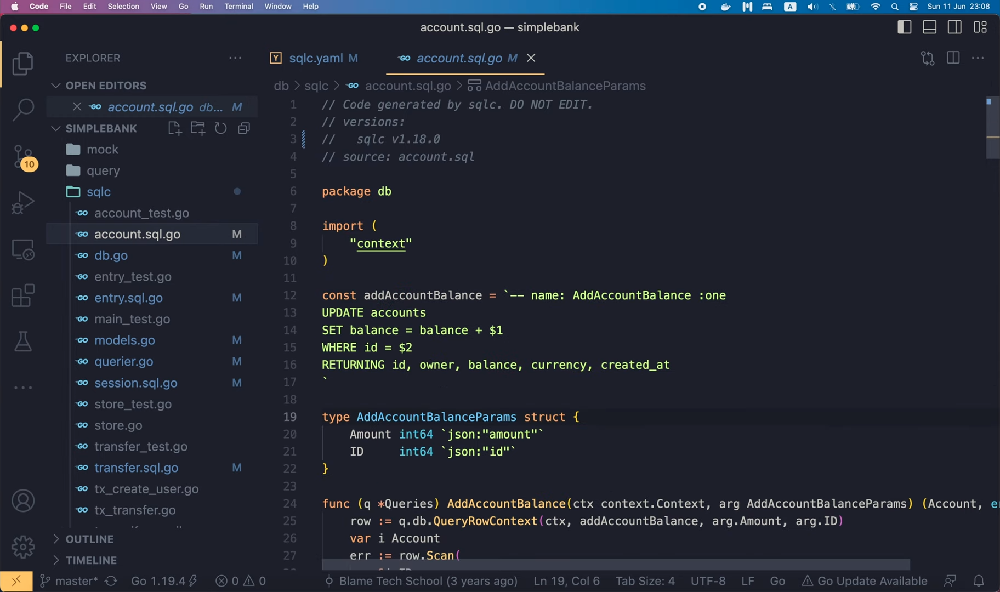

# Настраиваем вторую версию sqlc для Go и Postgres

[Оригинал](https://www.youtube.com/watch?v=FfXE245HZB4)

Всем привет, добро пожаловать на мастер-класс по бэкенду. В нашем 
проекте мы часто использовали `sqlc` для генерации кода Golang, который 
помогает нам взаимодействовать с базой данных. С тех пор как мы его 
впервые установили, в `sqlc` было добавлено множество различных новых 
наработок, поэтому сегодня давайте попробуем обновить его до последней 
версии. Давайте начнём с того, что настроим нужную нам версию. 

## Настраиваем файл `sqlc.yaml`

Если вы посмотрите на [страницу документации](https://docs.sqlc.dev/en/latest/),
то увидите, что теперь существует два способа настройки `sqlc`.
В нашем проекте мы всё ещё используем [версию 1](https://docs.sqlc.dev/en/latest/reference/config.html#version-1),
поэтому давайте обновим его до более новой [версии](https://docs.sqlc.dev/en/latest/reference/config.html#version-2).
Я скопирую эту конфигурацию для второй версии,

```yaml
version: "2"
sql:
- schema: "postgresql/schema.sql"
  queries: "postgresql/query.sql"
  engine: "postgresql"
  gen:
    go: 
      package: "authors"
      out: "postgresql"
- schema: "mysql/schema.sql"
  queries: "mysql/query.sql"
  engine: "mysql"
  gen:
    go:
      package: "authors"
      out: "mysql"
```

и вставлю её в наш файл `sqlc.yaml`. В этом примере, они определили две 
схемы: одну – для Postgres и одну – для MySQL. Поскольку в нашем проекте 
мы используем только Postgres, я удалю настройки схемы для MySQL. После 
этого, поскольку названия полей для второй версии очень похожи на названия 
полей для версии 1, поэтому нетрудно разобраться, что там необходимо 
указать.

```yaml
version: "2"
sql:
- schema: "postgresql/schema.sql"
  queries: "postgresql/query.sql"
  engine: "postgresql"
  gen:
    go: 
      package: "authors"
      out: "postgresql"
```

Во-первых, в поле "schema" мы можем указать SQL файл, содержащий всю схему БД,
как в примере из документации, или мы также можем задать папку, содержащую 
все SQL файлы миграции, то есть "db/migration" для нашего проекта. Затем в 
поле "queries" необходимо указать папку, содержащую файлы SQL-запросов.
В нашем случае это "db/query". Поле "engine" равно "postgresql", поэтому 
нам не нужно его менять. Далее, в разделе конфигурации "gen" мы указываем 
`sqlc`, как генерировать код для выбранного нами языка программирования, 
то есть Golang. Поле "package" должно содержать название пакета Go, поэтому 
для него должно быть установлено значение "db", поскольку это пакет, 
который мы сейчас используем. Затем мы используем поле "out", чтобы 
указать `sqlc`, куда мы хотим записать сгенерированные файлы с кодом. В 
данном случае это должна быть папка "db/sqlc", точно так же, как мы задавали
поле "path" для версии 1. Остальная часть файла конфигурации представляет 
собой несколько логических флагов. Это позволяет нам дополнительно 
настраивать сгенерированный код. Нам придется отредактировать их отступы, 
чтобы они были выровнены по полям "package" и "out". Первый флаг —
"emit_json_tags". Для него установлено значение "true", поскольку мы 
хотим иметь теги JSON для структур модели БД. Поскольку мы не используем 
подготовленные запросы, второй флаг можно установить в значение "false", а 
лучше вообще убрать. Затем мы хотим создать интерфейс `Querier`, 
поскольку он будет использоваться для создания имитаций для unit
тестирования. Мы не хотим, чтобы `sqlc` использовал точные названия таблиц 
для структуры модели, потому что мы хотим, чтобы в качестве названия 
модели использовалась форма единственного числа названия таблицы. Так 
что этот флаг тоже можно убрать. Наконец, для параметра
"emit_empty_slices" установлено значение "true", поскольку мы хотим, 
чтобы при отсутствии результата запрос возвращал пустой срез, а не `nil`.
Существует множество других флагов, которые вы можете настроить, о них
вы можете узнать больше на [странице документации](https://docs.sqlc.dev/en/latest/reference/config.html#go).

```yaml
version: "2"
sql:
- schema: "db/migration"
  queries: "db/query"
  engine: "postgresql"
  gen:
    go: 
      package: "db"
      out: "db/sqlc"
      emit_json_tags: true
      emit_interface: true
      emit_empty_slices: true
```

Некоторые флаги, также очень полезные на мой взгляд, — это те, которые 
возвращают результирующую структуру в виде указателей или позволяют 
задавать структуры параметров функции в виде указателей. OK, итак, теперь
мы перенастроили `sqlc` для работы с новой второй версией. 

Давайте попробуем заново сгенерировать код. Но сначала я проверю текущую 
версию бинарного файла `sqlc`.

```shell
sqlc version
v1.17.2
```

Она равна 1.17.2, но если я не ошибаюсь, последняя на момент записи этого 
видео уже 1.18. Поэтому я запущу команду

```shell
brew upgrade sqlc
```

чтобы установить последнюю версию.



На рисунке видно, что `sqlc` действительно был обновлен до версии 1.18.0.

```shell
sqlc version
v1.18.0
```

Поэтому теперь давайте выполним команду `make sqlc`, чтобы повторно 
сгенерировать Golang код для наших запросов.

```shell
make sqlc
sqlc generate
```

Она успешно выполнилась! И в папке `db/sqlc` мы видим, что изменилось 
содержимое несколько файлов.



На самом деле, похоже, что сгенерированный Golang код не поменялся, а 
изменились только комментарий, содержащие версию `sqlc`, которая 
использовалась для генерации кода.

It's fine, as long as our codes still work well as before. So to make sure
of that, I'm gonna run some tests.

First, let's check if the database is running.

```shell
docker ps
```

The "docker ps" command doesn't show any containers, so let's run 
"docker ps -a" to list all of them.

```shell
docker ps -a
CONTAINER ID   IMAGE               COMMAND                    CREATED         STATUS                    PORTS    NAMES
c641c16b43e0   redis:7-alpine      "docker-entrypoint.s..."   7 months ago    Exited (0) 7 weeks ago             redis
3b411af7dc88   postgres:14-alpine  "docker-entrypoint.s..."   11 months ago   Exited (0) 7 weeks ago             postgres
```

OK, so both Postgres and Redis are stopped. 

Let's run "docker start postgres" and "docker start redis" to wake them up.

```shell
docker start postgres12 
postgres12
docker start redis 
redis
```

Alright, now both the containers are up and running.

```shell
docker ps
CONTAINER ID   IMAGE               COMMAND                    CREATED         STATUS          PORTS    NAMES
c641c16b43e0   redis:7-alpine      "docker-entrypoint.s..."   7 months ago    Up 3 seconds             redis
3b411af7dc88   postgres:14-alpine  "docker-entrypoint.s..."   11 months ago   Up 7 seconds             postgres
```

Let's clear the terminal, and run "make test".

```shell
make test
go test -v -cover -short ./...
...
PASS
coverage: 85.7% of statements
ok      github.com/techschool/simplebank/token    0.020s  coverage: 85.7% of statements
=== RUN   TestPassword
--- PASS: TestPassword (0.30s)
PASS
coverage: 35.5% of statements
ok      github.com/techschool/simplebank/util     0.328s  coverage: 35.5% of statements
?       github.com/techschool/simplebank/val      [no test files]
?       github.com/techschool/simplebank/worker   [no test files]
?       github.com/techschool/simplebank/worker/mock      [no test files]
```

This will run all tests in our project, including the DB test. So looks
like everything is working just fine. All test passed. Excellent!

So we've successfully updated `sqlc` configuration to version 2, and `sqlc` 
executable binary to 1.18.

In the next lecture, I'm gonna show you how to switch the db driver from 
`lib/pq` to `pgx`, since `lib/pq` package has been set to maintenance mode 
for a while, and `pgx` seems to be a better implementation, with more 
features.

Thanks a lot for watching this video, it was short, but I hope it's still 
useful for you. Happy learning! And I'll see you soon in the next lecture!