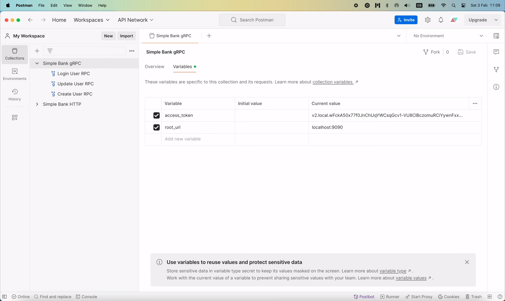
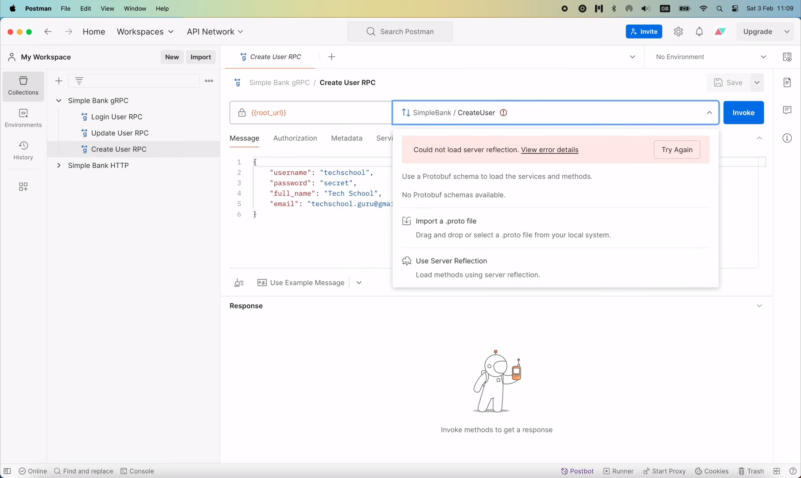
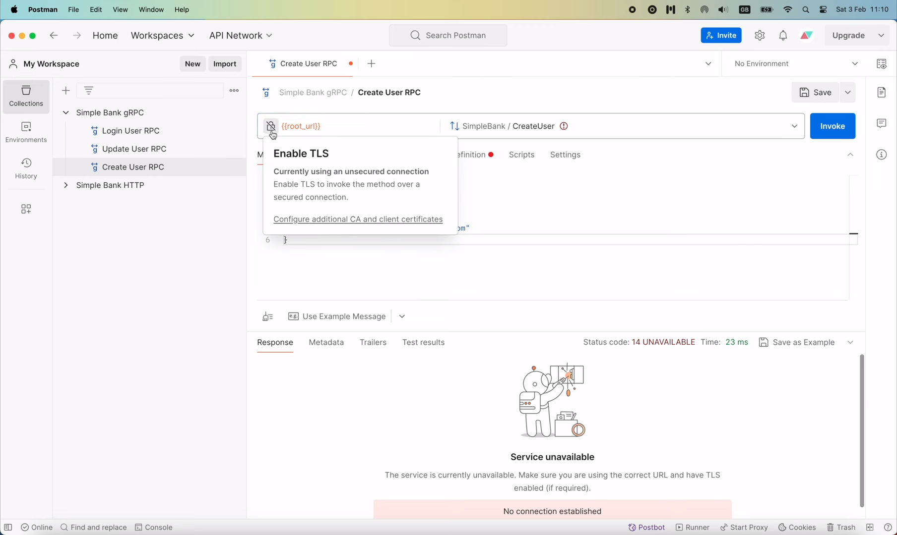
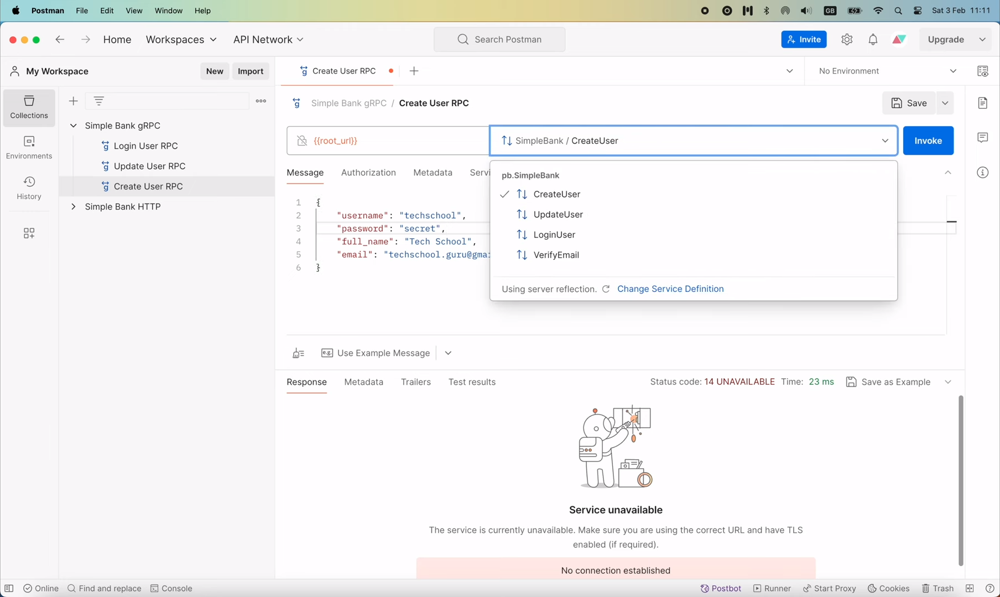
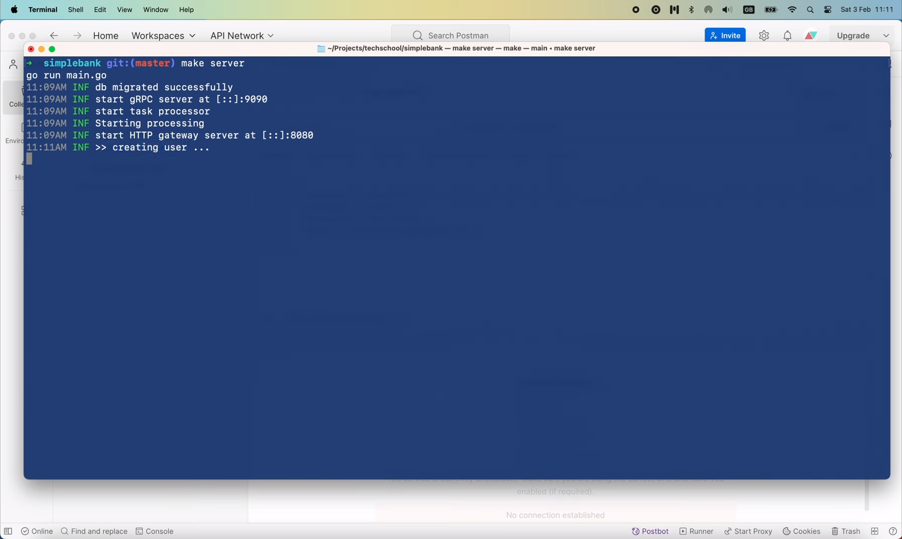
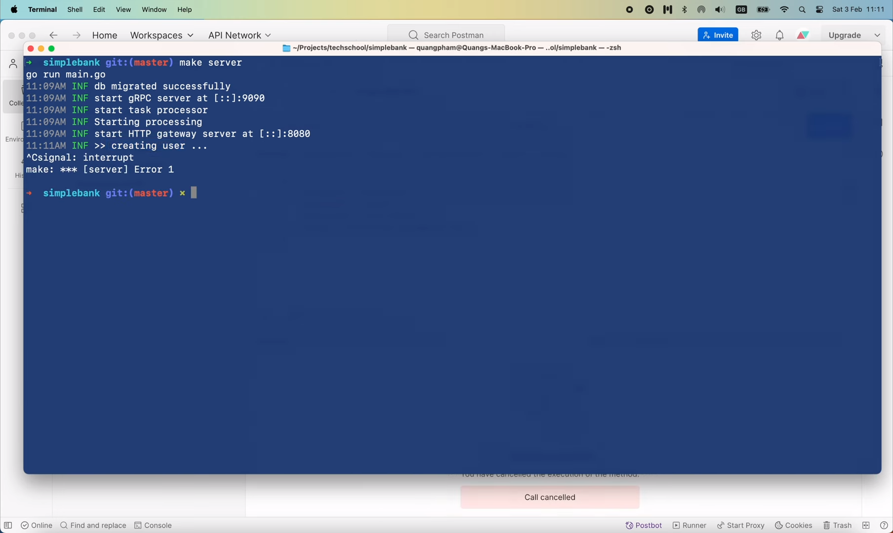

# Graceful shutdown gRPC/HTTP servers and async worker

[Original video](https://www.youtube.com/watch?v=TdB2W8l4dHw)

Hello everyone, welcome to the backend master class! In this video, we're
gonna learn how to gracefully shutdown servers in Golang. To understand
why it is so important let me show you an example. The idea is, we will
try to stop the server while it is still processing a request to see what
happens.

In the `CreateUser` RPC's handler function, let's pretend that the call 
to create user transaction takes a long time to complete.

```go
func (server *Server) CreateUser(ctx context.Context, req *pb.CreateUserRequest) (*pb.CreateUserResponse, error) {
    ...
    
    log.Info().Msg(">> creating user ...")
    time.Sleep(10 * time.Second)
    
    txResult, err := server.store.CreateUserTx(ctx, arg)
    ...
}
```

So here, I'm gonna write an info log, saying "creating user" and use 
`time.Sleep()` function to wait for 10 seconds.

Then, right before returning the response let's write another log: "done 
creating user".

```go
func (server *Server) CreateUser(ctx context.Context, req *pb.CreateUserRequest) (*pb.CreateUserResponse, error) {
    ...

    log.Info().Msg(">> creating user ...")
    return rsp, nil
}
```

Alright, now I'm gonna start the server.

```shell
make server
go run main.go
11:09AM INF db migrated successfully
11:09AM INF start gRPC server at [::]:9090
11:09AM INF start task processor
11:09AM INF Starting processing
11:09AM INF start HTTP gateway server at [::]:8080
```

The gRPC server is serving requests on port `9090`, so, in Postman, we have 
to change the `root_url` variable to `localhost:9090`.



Now, in the Create User RPC, make sure the `root_url` is correct, and try
to reload server reflection.



It's still not able to communicate with the server. That's because we're
still enabling TLS. 

So let's disable it by clicking on this lock icon.



OK, so now the server reflection is successfully loaded.



We can go ahead and send the `CreateUser` request. In the server logs, it
says: "creating user...".



Now I'm gonna press `Control + C` to stop the server.



So you see the problem?

The server stops immediately, it doesn't wait for the `CreateUser` request
to complete.

So we're just lost 1 user.

## Why graceful shutdown

This can happen anytime you deploy new code to the server, and if your 
server has high traffic, a lot of ongoing requests can be interrupted
just like that. And it can happen to the ongoing async tasks as well.

So that why we need to add graceful shutdown to our server, so that it
can stop receiving new requests, and wait for all ongoing requests to be
completed before shutting down.

Let's open the `main.go` file and learn how to implement this feature.

In order to know when to shut down, we must listen to some interrupt 
signals. So I'm gonna declare a list of signals on top of the `main` 
function. There are many OS signals, but normally we only need to care
about 3: `os.Interrupt`, `syscall.SIGTERM` and `syscall.SIGINT` signals.

```go
var interruptSignals = []os.Signal{
    os.Interrupt,
    syscall.SIGTERM,
    syscall.SIGINT,
}

func main() {
    ...
}
```

Then, in the `main` function, we're gonna call `signal.NotifyContext()`.
This function basically registers a list of signal we want to listen to,
when one signal come, the context will be marked as `Done`, and we know 
it's time to gracefully shut down the server. Here, I'm gonna pass in 
`context.Background()` as the parent context, and the list of interrupt
signals that we've just declared above.

```go
ctx, stop := signal.NotifyContext(context.Background(), interruptSignals...)
```

This function will return a context and a stop (or cancel) function. We
should use the `defer` keyword to make sure that the `stop()` function 
will be called right before the `main` function exit.

```go
ctx, stop := signal.NotifyContext(context.Background(), interruptSignals...)
defer stop()
```

And the context variable `ctx` will be the one that receives the interrupt 
signals. We can use it when creating a DB connection pool here.

```go
ctx, stop := signal.NotifyContext(context.Background(), interruptSignals...)
defer stop()

connPool, err := pgxpool.New(ctx, config.DBSource)
```

But the main usage of it would be in these 3 functions

```go
go runTaskProcessor(config, redisOpt, store)
go runGatewayServer(config, store, taskDistributor)
runGrpcServer(config, store, taskDistributor)
```

that run the gRPC/HTTP servers and the task processor.

Now, we will make sure all of them are running on a separate go routine,
and wait for them to shut down once there is an interrupt signal.

To do that, I'm gonna use error group package. Let's call 
`errgroup. WithContext`, and pass in the context we created above.

```go
taskDistributor := worker.NewRedisTaskDistributor(redisOpt)

errgroup.WithContext(ctx)

go runTaskProcessor(config, redisOpt, store)
```

This function will return a wait group, and another context that derives
from the original one.

```go
waitGroup, ctx := errgroup.WithContext(ctx)
```

Now, I'm gonna remove this go routine call, and pass the `waitGroup` and the
context into each of these 3 functions.

```go
runTaskProcessor(ctx, waitGroup, config, redisOpt, store)
runGatewayServer(ctx, waitGroup, config, store, taskDistributor)
runGrpcServer(ctx, waitGroup, config, store, taskDistributor)
```

The idea is, we will use those 2 variables to run the servers and workers
in separate go routine inside the function themselves, and wait for the
interrupt signal to gracefully shutdown.

At the end of the `main` function, we'll have to call `waitGroup.Wait()`
to wait for all of the go routine to complete before exiting the `main`
function.

```go
func main() {
    ...
    
    runTaskProcessor(ctx, waitGroup, config, redisOpt, store)
    runGatewayServer(ctx, waitGroup, config, store, taskDistributor)
    runGrpcServer(ctx, waitGroup, config, store, taskDistributor)
    
    err = waitGroup.Wait()
    if err != nil {
        log.Fatal().Err(err).Msg("error from wait group")
    }
}
```

If this wait returns an error, we simply write a fatal log message: "error
from wait group". Alright, now it's time to update these 3 functions.

Let's start with the `runGrpcServer` function. I'm gonna add 2 new input
arguments to this function: a context and a `waitGroup`.

```go
func runGrpcServer(
    ctx context.Context,
    waitGroup *errgroup.Group,
    config util.Config, store db.Store, taskDistributor worker.TaskDistributor) {
    ...
}
```

Next, let's call `waitGroup.Go()` to start a new go routine.

```go
waitGroup.Go(func() error {

})
```

This will take a function as input. And that function must return an error
as output.

Then, I'm gonna move this piece of codes that start the gRPC server into
this function.

```go
func runGrpcServer(
    ctx context.Context,
    waitGroup *errgroup.Group,
    config util.Config, store db.Store, taskDistributor worker.TaskDistributor) {
    ...

	listener, err := net.Listen("tcp", config.GRPCServerAddress)
    if err != nil {
        log.Fatal().Err(err).Msg("cannot create listener")
    }
	
    waitGroup.Go(func() error {
        log.Info().Msgf("start gRPC server at %s", listener.Addr().String())
        err = grpcServer.Serve(listener)
        if err != nil {
            log.Fatal().Err(err).Msg("cannot start gRPC server")
        }
    })
}
```

So now, the gRPC server will be started in a separate go routine. If this
`grpcServer.Serve()` returns an error, we won't write a fatal log anymore,
but we will just write an error log, and return the error. And in the end,
if no error occurs, we simply return `nil`.

```go
func runGrpcServer(
    ctx context.Context,
    waitGroup *errgroup.Group,
    config util.Config,
    store db.Store,
    taskDistributor worker.TaskDistributor,
) {
    ...
    waitGroup.Go(func() error {
        log.Info().Msgf("start gRPC server at %s", listener.Addr().String())
    
        err = grpcServer.Serve(listener)
        if err != nil {
            log.Error().Err(err).Msg("cannot start gRPC server")
            return err
        }
    
        return nil
    })
}
```

OK, so that's done the part of starting the server in a go routine. Now 
comes the part that listen to the interrupt signals and gracefully shutdown
the server.

We'll also do that in a separate go routine, so let's call `waitGroup.Go`
to start a new one. Note that we have the input context that will report
the interrupt signals when it occurs. So here, let's read from 
`ctx.Done()` channel. This call will be blocked until the context is done 
(which means there's an interrupt signal). When this happens, we should 
gracefully shut down the server, and we do that by calling 
`grpcServer.GracefulStop()`. Once it's done, we can write a log here, 
saying "gRPC server is stopped". And finally return `nil` at the end of 
the function.

```go
func runGrpcServer(
    ctx context.Context,
    waitGroup *errgroup.Group,
    config util.Config,
    store db.Store,
    taskDistributor worker.TaskDistributor,
) {
    ...
    waitGroup.Go(func() error {
        ...
    })

    waitGroup.Go(func() error {
        <-ctx.Done()
        log.Info().Msg("gracefully shutdown gRPC server")

        grpcServer.GracefulStop()
        log.Info().Msg("gRPC server is stopped")
        
        return nil
    })
}
```

That's basically it. We've now enabled graceful shutdown for our gRPC 
server. Next, let's do the same for the HTTP gateway server.

I'm gonna add the 2 new input arguments: context and wait group to this
function.

```go
func runGatewayServer(
	ctx context.Context,
	waitGroup *errgroup.Group,
	config util.Config,
	store db.Store,
	taskDistributor worker.TaskDistributor,
) {
    ...
}
```

Here we can get rid of this context creation, and just use the input
context to register the server.

```go
func runGatewayServer(
    ctx context.Context,
    waitGroup *errgroup.Group,
    config util.Config,
    store db.Store,
    taskDistributor worker.TaskDistributor,
) {
    ...
	grpcMux := runtime.NewServeMux(jsonOption)

    err = pb.RegisterSimpleBankHandlerServer(ctx, grpcMux, server)
	...
}
```

Then, right before the listener, I'm gonna declare a new `httpServer` 
variable, since we're gonna need it to gracefully shutdown the server 
later. There are 2 values that we must provide to this object. First, the
handler function, which we can set to `gapi.HttpLogger(mux)`, 

```go
func runGatewayServer(
    ctx context.Context,
    waitGroup *errgroup.Group,
    config util.Config,
    store db.Store,
    taskDistributor worker.TaskDistributor,
) {
    ...
    swaggerHandler := http.StripPrefix("/swagger/", http.FileServer(statikFS))
    mux.Handle("/swagger/", swaggerHandler)
	
    httpServer := &http.Server{
        Handler: gapi.HttpLogger(mux),
    }
	
    ...
}
```

The remaining part of the video is unavailable because the 
user has restricted access to sponsors only.

